<picture>
  <source media="(prefers-color-scheme: dark)" srcset="./assets/banner-dark.svg">
  <source media="(prefers-color-scheme: light)" srcset="./assets/banner-light.svg">
  
</picture>

<p align="center">
  <a href="https://faresgdoura.dev"></a>
  <a href="https://www.linkedin.com/in/fares-gdoura"></a>
  <a href="mailto:gdourafares@gmail.com"></a>
</p>

## 👋 Hey, I'm Fares

I build web products end to end — from the database schema to the last pixel of the UI.
For the past 6+ years I've been shipping **Laravel** backends and **Vue / Nuxt** frontends
for startups, agencies and clients worldwide, and today I run my own web agency,
**Pixel Quest Innovations**, out of Dubai.
These days AI is a core part of how I work: I'm proficient with it and I've built a solid,
repeatable development cycle around it that lets me ship faster without cutting corners.

```yaml
role:      Full-Stack Developer · Founder @ Pixel Quest Innovations
based_in:  Dubai, UAE 🇦🇪
certified: [Laravel, Vue.js]
ai:        proficient — AI is built into my daily dev cycle
focus:     [SaaS platforms, dashboards, API integrations, fast Nuxt sites]
open_to:   freelance & contract work — say hi 👇
```

## 🛠️ Stack

<p align="center">
  <br>
  <br>
  
</p>

## 🔭 Right now

- 🌐 Running **Pixel Quest Innovations** — a web agency building web apps & sites for clients
- 📊 Shipping client dashboards and ad-platform integrations (Meta Ads API) in Laravel
- 🤖 Building **with AI** every day — I'm proficient with AI coding tools and run a solid AI-assisted
  development cycle: plan → generate → review → test → ship, with me owning every line that goes out

## 🐍 Contributions

<picture>
  <source media="(prefers-color-scheme: dark)" srcset="https://raw.githubusercontent.com/faresg/faresg/output/github-contribution-grid-snake-dark.svg">
  <source media="(prefers-color-scheme: light)" srcset="https://raw.githubusercontent.com/faresg/faresg/output/github-contribution-grid-snake.svg">
  
</picture>

<p align="center"><sub>Got a project in mind? <a href="mailto:gdourafares@gmail.com">Let's talk</a> ✨</sub></p>
